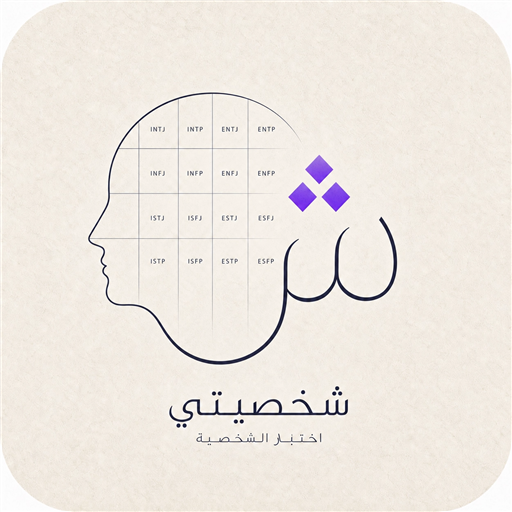
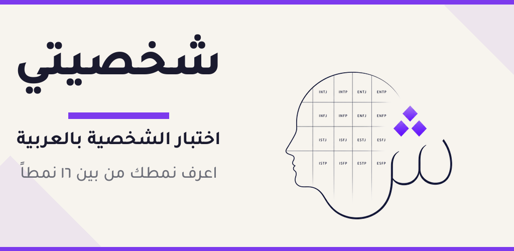
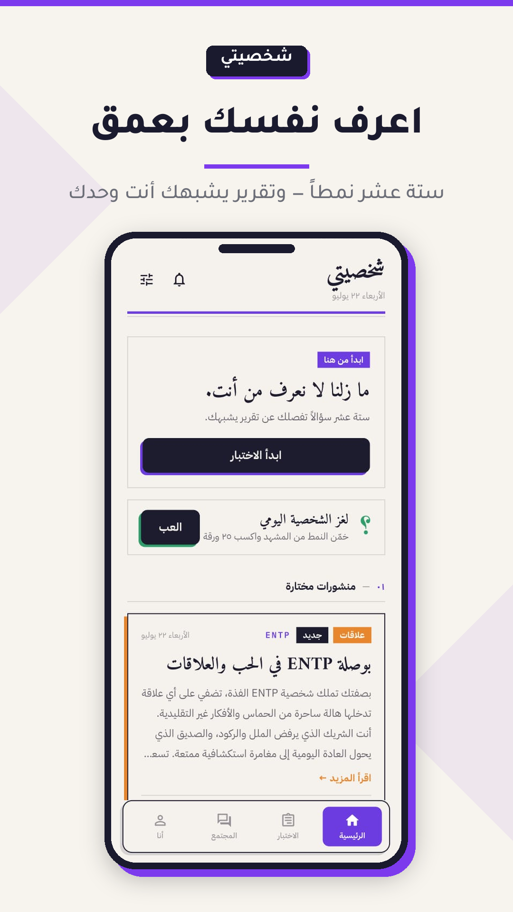
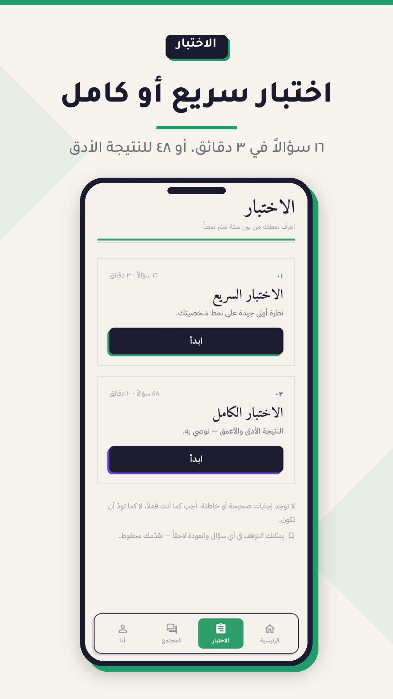
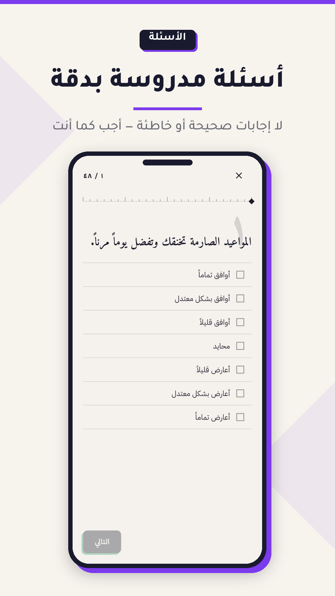
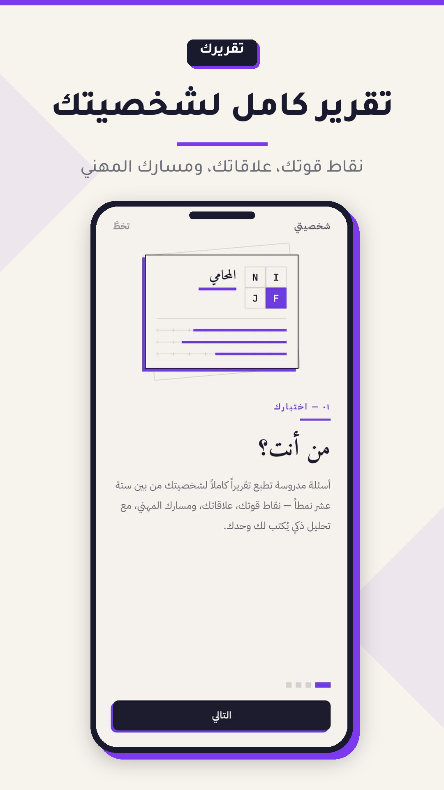
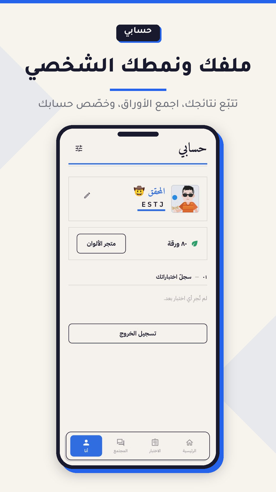

<p align="center">
  
</p>

<h1 align="center">شخصيتي — Shakhsiyati</h1>

<p align="center">
  تطبيق عربي لاكتشاف نمط شخصيتك من بين 16 نمطاً، مع تحليل ذكي مخصص ومجتمع يفهمك.
  <br/>
  <i>An Arabic personality-discovery app with AI-powered analysis and a social community.</i>
</p>

<p align="center">
  <a href="https://play.google.com/store/apps/details?id=com.shakhsiyati.app">
    
  </a>
</p>

<p align="center">
  
</p>

---

## لقطات من التطبيق

<p align="center">
  
  
  
  
  
</p>

---

<div dir="rtl">

## المميزات

### اختبار الشخصية
- اختبار سريع (16 سؤالاً) أو كامل (48 سؤالاً) بأسئلة عربية مدروسة
- تقرير غني: نقاط القوة والضعف، العلاقات، المسار المهني، ومشاهير من نفس النمط
- تحليل شخصي يُولَّد بالذكاء الاصطناعي بناءً على نسب المستخدم الدقيقة
- حفظ التقدم وإكمال الاختبار في أي وقت

### المجتمع
- مشاركة الخواطر مع إظهار نمط الشخصية
- فلتر «نمطي» لعرض منشورات أصحاب النمط نفسه
- 16 شخصية افتراضية (موسومة بـ AI) تنشر وترد بأسلوب نمطها
- إعجابات وتعليقات ونظام دعم بالأوراق

### العب واكسب
- لغز شخصية يومي جديد
- جمع «الأوراق» لتلوين الاسم وفتح أفاتارات مميزة

### محتوى يومي
- مقالات تُنشر يومياً ومفلترة حسب نمط الشخصية
- إشعارات لحظية بكل تفاعل

### الخصوصية
- تجربة الاختبار كضيف بدون تسجيل
- أسماء مستعارة في المجتمع
- حذف الحساب وكل البيانات نهائياً من داخل التطبيق

</div>

---

## Tech Stack

| Layer | Technology |
|---|---|
| Mobile | Flutter, Dart, Provider, go_router |
| Backend | Supabase (Auth, PostgreSQL, Edge Functions) |
| AI | Google Gemini via Supabase Edge Functions |
| Auth | Google Sign-In, guest mode |
| Notifications | OneSignal |
| UI | Custom Arabic typography (Amiri, IBM Plex Sans Arabic), Lottie animations, audio effects |

### Edge Functions
| Function | Purpose |
|---|---|
| `analyze-result` | Generates a personalized Arabic analysis from the test results |
| `generate-article` | Publishes daily articles tailored to each personality type |
| `generate-persona-post` | AI personas write community posts in their type's style |
| `process-replies` | AI personas reply to user comments |
| `generate-puzzle` | Creates the daily personality puzzle |
| `create-post` | Handles community post creation |

## Project Structure
```
lib/
├── core/        # theme, routing, constants
├── data/        # data sources & Supabase access
├── models/      # data models
├── providers/   # state management (Provider)
├── screens/     # app screens
├── widgets/     # reusable UI components
└── main.dart
supabase/
└── functions/   # Edge Functions (AI & server logic)
```

## Legal
- [Privacy Policy](docs/privacy.html) · [Terms](docs/terms.html) · [Account Deletion](docs/delete-account.html)

> ملاحظة: الاختبار للاستبصار الذاتي والتسلية، وليس تشخيصاً نفسياً.

---

<p align="center">Built by <a href="https://github.com/mohamed12150">Mohamed Al-khair Rabeh</a></p>
